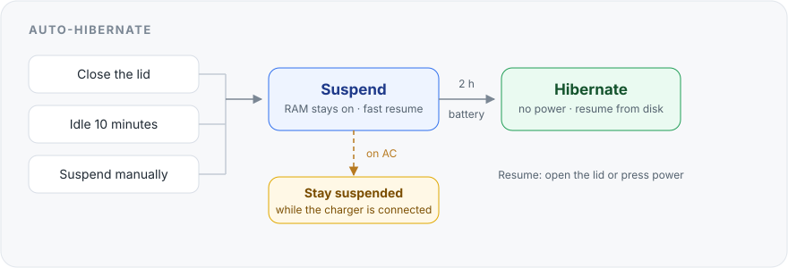

<p align="center">
  
</p>

# Omatweaks

Small, reversible tweaks for [Omarchy](https://omarchy.org/).
One command turns a tweak on. One command removes it.

**auto-hibernate** — close the lid and walk away. The laptop suspends, then
hibernates before the battery dies. Plugged in, it simply stays suspended.



**Suspend** resumes instantly but slowly drains the battery. **Hibernate**
writes memory to disk, uses almost no power, and resumes in a few seconds.

Unofficial. Not affiliated with Omarchy.

## Install

One copy-paste. Omarchy already has `~/.local/bin` on `PATH`.

```bash
git clone --depth=1 https://github.com/psadowski0/omatweaks.git ~/.local/share/omatweaks && ~/.local/share/omatweaks/omatweaks link
```

## Use

```bash
omatweaks list                      # what is available
omatweaks auto-hibernate enable     # turn it on (asks for sudo once)
omatweaks auto-hibernate status     # what is happening now
omatweaks auto-hibernate disable    # turn it off, remove everything
```

`enable` and `disable` are safe to repeat. Requires Omarchy, `jq`, `git`, and
working hibernation (`omarchy-hibernation-available`).

## What it does

| You… | On battery | Plugged in |
|---|---|---|
| Close the lid | suspend → hibernate after 2 h | suspend; hibernate later if you unplug |
| Leave it idle | suspend after 10 min → hibernate after 2 h | nothing |
| Suspend from the menu, key, or `systemctl suspend` | suspend → hibernate after 2 h | suspend; hibernate later if you unplug |

It waits while you are watching a video, on a call, or using **stay awake**.

## Tested on real hardware

**Human-supervised, on real hardware, in real-world conditions.** A person
closed the real lid, plugged in the real charger, and left the laptop idle. Not
a VM, not a simulation.

| Scenario | Result |
|---|---|
| Lid closed on battery | suspend → hibernate → resume ✅ |
| Lid closed on AC | stays suspended ✅ |
| Charger unplugged while suspended | hibernates at the next check ✅ |
| Idle on battery | automatic suspend ✅ |
| Idle on AC | no sleep ✅ |
| Stay-awake / video / call | no sleep ✅ |
| Manual suspend | suspend → hibernate → resume ✅ |
| Early-wake race (systemd #38193) | retried, hibernated ✅ |
| Disable → enable | no leftovers ✅ |

**Machine:** Framework Laptop 13 (AMD Ryzen 7040 series, Ryzen 5 7640U, 14.9 GiB
RAM) · BIOS 03.20 · Omarchy 4.5.0 on Arch · kernel 7.2.15 · systemd 262 ·
`s2idle` · encrypted 14.9 GiB swapfile.

**Tested:** 6 November 2026.

Not tested on purpose: below 5% battery (unsafe to force) and hybrid sleep
(this tweak does not touch it). The idle path's hibernate step is the same
systemd path verified by the lid and manual tests.

## Good to know

- It never hibernates while the charger stays connected.
- On battery it waits **2 hours**, so a short break stays in fast suspend.
- Changing your mind is one command: `omatweaks auto-hibernate disable`.

### When not to insist on hibernation

- **On AC** — suspend is enough.
- **A short break** — the 2-hour delay never gets there.
- **Video, call, stay awake** — it waits on purpose.
- **Unreliable resume** — fix hibernation first; unreliable hibernation is worse
  than suspend.
- **A few percent of battery** — plug in if you can; the image may not finish
  writing.

## Update

```bash
omatweaks update
```

## Remove

One copy-paste:

```bash
omatweaks auto-hibernate disable && omatweaks unlink && rm -rf ~/.local/share/omatweaks
```

## More

- [How it works](docs/how-it-works.md) — the systemd pieces, files, and settings.
- [Full test log](docs/testing.md) — every scenario and the evidence behind it.
- [Contributing](CONTRIBUTING.md)
- MIT license — see [LICENSE](LICENSE).
