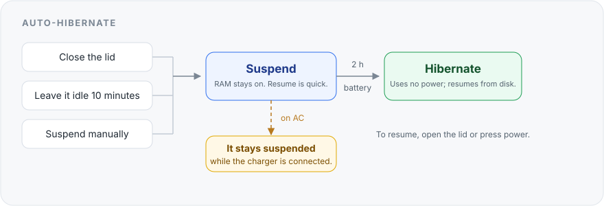

# auto-hibernate

auto-hibernate is an independent module in [Omasetup](../../README.md). It runs
on its own and does not need the Omasetup app.

## What is it?

auto-hibernate makes the laptop suspend first and hibernate later while it is
on battery. It never hibernates while the charger stays connected.

## How does it help you?

Close the lid and walk away. The laptop suspends, then hibernates before the
battery dies. When it is plugged in, it stays suspended instead.



**Suspend** resumes instantly, but it slowly drains the battery. **Hibernate**
writes memory to disk, uses almost no power, and resumes in a few seconds.

## Install

Run this command once. Omarchy already has `~/.local/bin` on `PATH`.

```bash
git clone --depth=1 https://github.com/psadowski0/omasetup.git \
  ~/.local/share/omasetup && ~/.local/share/omasetup/modules/auto-hibernate/auto-hibernate link
```

Then run `auto-hibernate enable` and allow sudo once.

## Use

```bash
auto-hibernate enable     # Turns it on (asks for sudo once).
auto-hibernate status     # Shows what is happening now.
auto-hibernate disable    # Turns it off and removes everything.
```

You can run `enable` and `disable` more than once. The module requires Omarchy,
`jq`, `git`, and working hibernation (`omarchy-hibernation-available`).

## What it does

| If you… | On battery | When plugged in |
|---|---|---|
| Close the lid | It suspends, then hibernates after 2 hours. | It suspends. If you unplug it, it hibernates later. |
| Leave it idle | It suspends after 10 minutes, then hibernates after 2 hours. | Nothing happens. |
| Suspend from the menu, a key, or `systemctl suspend` | It suspends, then hibernates after 2 hours. | It suspends. If you unplug it, it hibernates later. |

It also waits while you are watching a video, on a call, or using **stay awake**.

## Tested in the real world

<p align="center">
  
</p>

The auto-hibernate module was tested by a human, on real hardware, in real-world
conditions. A person closed the real lid, plugged in and unplugged the real
charger, and left the laptop idle. It was not a virtual machine or a simulation.

| Scenario | Result |
|---|---|
| Lid closed on battery | It suspends, hibernates, and resumes. ✅ |
| Lid closed on AC | It stays suspended. ✅ |
| Charger unplugged while suspended | It hibernates at the next check. ✅ |
| Idle on battery | It suspends automatically. ✅ |
| Idle on AC | It does not sleep. ✅ |
| Stay-awake, video, or call | It does not sleep. ✅ |
| Manual suspend | It suspends, hibernates, and resumes. ✅ |
| Early-wake race (systemd #38193) | It retries and then hibernates. ✅ |
| Disable → enable | It leaves no leftovers. ✅ |

**Machine:** Framework Laptop 13 (AMD Ryzen 7040 series, Ryzen 5 7640U, 14.9 GiB
RAM) · BIOS 03.20 · Omarchy 4.5.0 on Arch · kernel 7.2.15 · systemd 262 ·
`s2idle` · encrypted 14.9 GiB swapfile.

**Tested:** 6 November 2026.

The original hardware tests ran before this module was packaged for Omasetup.
The auto-hibernate logic is unchanged. The module was then tested again with the
new command and systemd names; the result is in the
[full test log](docs/testing.md).

Two cases were not tested on purpose. The first is below 5% battery, because
draining the battery to force that case is unsafe. The second is hybrid sleep,
because this module does not change it. The idle path uses the same hibernation
step that the lid and manual tests verified.

## Good to know

- It never hibernates while the charger stays connected.
- On battery it waits **2 hours**, so a short break stays in fast suspend.
- If you change your mind, one command turns it off: `auto-hibernate disable`.

### When not to insist on hibernation

- **On AC:** Suspend is enough.
- **A short break:** The 2-hour delay never gets there.
- **Video, a call, or stay awake:** It waits on purpose.
- **Unreliable resume:** Fix hibernation first. Unreliable hibernation is worse
  than suspend.
- **A few percent of battery:** Plug in if you can. The image may not finish
  writing.

## Update

Run this command to get the latest version:

```bash
auto-hibernate update
```

## Remove

Run this command to remove everything:

```bash
auto-hibernate disable && auto-hibernate unlink && rm -rf ~/.local/share/omasetup
```

## More

- [How it works](docs/how-it-works.md) explains the systemd pieces, files, and
  settings.
- [Full test log](docs/testing.md) lists every scenario and the evidence behind
  it.
- [Omasetup](../../README.md) explains the project that hosts this module.
- [Contributing](../../CONTRIBUTING.md) explains how to add a module.
- Omasetup uses the MIT license; see [LICENSE](../../LICENSE).
