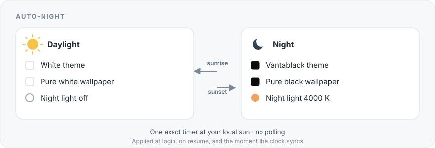

# auto-night

auto-night is an independent module in [Omasetup](../../README.md). It runs on
its own and does not need the Omasetup app.

## What is it?

auto-night switches your desktop with the sun. In daylight it uses the **White**
theme with a pure white wallpaper. After sunset it uses the **Vantablack** theme
with a pure black wallpaper, and turns on night light at 4000 K. At sunrise it
changes back.

The switch happens at your local sunrise and sunset, so it follows the seasons
instead of a fixed clock time.

## How does it help you?

A bright white desktop at midnight is hard on the eyes. A black desktop at noon
is hard to read. auto-night keeps the screen in step with the room: bright while
the sun is up, dim and warm after it sets.



## Install

Run this command once. Omarchy already has `~/.local/bin` on `PATH`.

```bash
git clone --depth=1 https://github.com/psadowski0/omasetup.git \
  ~/.local/share/omasetup && ~/.local/share/omasetup/modules/auto-night/auto-night link
```

Then run `auto-night enable`. It applies the current preset right away. If the
clock is clearly wrong, it waits for the clock to synchronize first, then
applies. No sudo is needed.

## Use

```bash
auto-night enable      # Turns it on and applies the current preset now.
auto-night status      # Shows the place, the sun times, and what will happen next.
auto-night verify      # Checks that the units, wallpapers, and timer are ready.
auto-night location    # Shows the place the sun times come from.
auto-night disable     # Turns it off and removes only what it added.
```

You can run `enable` and `disable` more than once. The module needs Omarchy,
Python 3, and systemd user services.

### Choose a place

By default the module reuses the place already set in Omarchy's **world clock**.
It never uses your IP address, so a VPN does not move your sunrise.

```bash
auto-night location                    # Show the place and where it came from.
auto-night location --set 52.23,21.01   # Pin a latitude and longitude.
auto-night location --clear            # Go back to the automatic choice.
```

The automatic choice, in order:

1. A location you pinned with `--set`.
2. The world clock's **here** place, if its timezone matches yours.
3. The world clock's **home city**.
4. The city of your system timezone (for example `Europe/Warsaw` → Warsaw).

If the world clock has no city for your timezone, the module uses the zone's
standard offset instead. It never guesses from the network.

## What it does

| When | Theme | Wallpaper | Night light |
|---|---|---|---|
| Sunrise to sunset | White | Pure white | Off |
| Sunset to sunrise | Vantablack | Pure black | On at 4000 K |

The two wallpapers are installed as part of the module. auto-night sets the
wallpaper at every period change, so the desktop returns to the pure white or
pure black image at each sunrise and sunset. A manual theme change is respected:
if you pick another theme between a sunrise and a sunset, auto-night does not
undo it. The next sunrise or sunset applies the preset again.

## Good to know

- **One exact trigger.** auto-night arms one systemd timer for the next sunrise
  or sunset. It does not poll, and there is no hourly or 15-second check.
- **After sleep, hibernate, or power loss.** The desktop is corrected when the
  machine comes back: at boot before the desktop appears, or when an overdue
  timer fires after resume.
- **A wrong clock.** If the clock is clearly wrong, auto-night leaves the theme
  alone and waits for the system clock to synchronize. It applies the correct
  preset the moment the sync lands.
- **Night light.** It is set at login as well, because hyprsunset does not
  survive a logout. Omarchy's own 07:00 hyprsunset profile is disabled while the
  module is on and restored byte-for-byte on disable.
- **Polar regions.** In polar night it stays dark; in midnight sun it stays
  light.
- **The lock screen.** The palette updates while locked. The blurred wallpaper
  is captured when the screen locks, so it can lag behind until you unlock.

### Is it always instant?

At the exact sunrise or sunset, while you are logged in and the machine is
awake, yes: the timer is armed to the second and starts the change immediately.
It cannot be instant in these cases, because the correct answer is not known or
the session is not running:

| Situation | What happens |
|---|---|
| The clock is wrong at boot | It waits for the clock to sync, then applies at once. |
| Suspended or hibernated across the change | It applies when the machine resumes. |
| Powered off across the change | It applies at boot, before the desktop appears. |
| Logged out | It applies at your next login. |
| Locked across the change | The palette updates; the blurred wallpaper catches up at unlock. |

## Tested in the real world

<p align="center">
  
</p>

Tested on 11 November 2026 on real hardware: Framework Laptop 13, Omarchy
4.5.0-3, Hyprland 0.56.2, systemd 262.1.

A disposable sandbox ran 82 checks on the command and 16 checks on the sun
logic. The sun logic was also compared with the world clock's own JavaScript
across 384 cases, with zero mismatches.

On the real machine:

- `enable` applied the night preset: Vantablack, the black wallpaper, night
  light at 4000 K, and one timer for the next sunrise.
- A simulated daytime trigger switched to White with the white wallpaper and
  turned night light off; a simulated night trigger switched back.
- A manual theme change between triggers was left alone, then replaced at the
  next sunrise.
- `disable` left the theme, wallpaper, and night light exactly as they were,
  removed the units and timers, and restored `hyprsunset.conf` byte-for-byte.

A real sunrise or sunset was not waited for; the timer was verified to be armed
in the real systemd, and the state machine was driven with a test clock. The
[full test log](docs/testing.md) lists every scenario.

## Update

```bash
auto-night update
auto-night enable
```

`update` pulls the checkout. Run `enable` again so the units and wallpapers
match the new version.

## Remove

```bash
auto-night disable && auto-night unlink && rm -rf ~/.local/share/omasetup
```

`disable` removes the units, the timers, and the state, and restores your
hyprsunset configuration and remembered theme backgrounds. It removes the
wallpaper it installed unless that wallpaper is the one on screen, so the
desktop never goes blank. The theme, wallpaper, and night light stay as they are
at that moment.

## More

- [How it works](docs/how-it-works.md) explains the trigger, the clock rules,
  the sun math, and every file the module touches.
- [Full test log](docs/testing.md) lists every scenario and the evidence behind
  it.
- [Omasetup](../../README.md) explains the project that hosts this module.
- [Contributing](../../CONTRIBUTING.md) explains how to add a module.
- Omasetup uses the MIT license; see [LICENSE](../../LICENSE).
