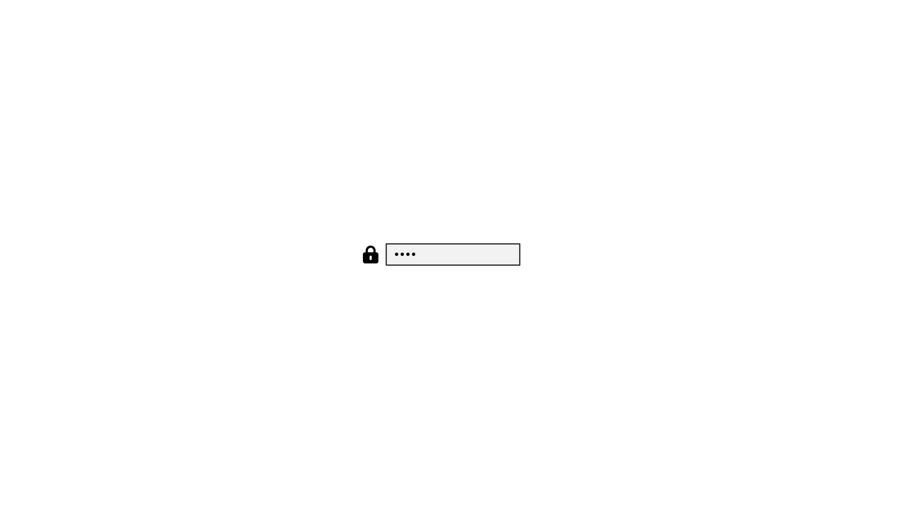

# unlock-themes

unlock-themes is an independent module in [Omasetup](../../README.md). It runs
on its own and does not need the Omasetup app.

## What is it?

unlock-themes adds two unlock screens to **Appearance → Unlock**. One uses the
White palette. The other uses the Vantablack palette. Both show no logo, and
the password field is exactly centered.

## How does it help you?

You get a clean unlock screen without changing your desktop theme. The password
field is exactly centered, horizontally and vertically, and the lock icon stays
slightly to its left. Stock unlock themes keep their original layout.

| White No Logo | Vantablack No Logo |
|---|---|
|  |  |

## Install

Run this command once. Omarchy already has `~/.local/bin` on `PATH`.

```bash
git clone --depth=1 https://github.com/psadowski0/omasetup.git \
  ~/.local/share/omasetup && ~/.local/share/omasetup/modules/unlock-themes/unlock-themes link
```

Then run `unlock-themes enable`. The first `enable` asks for sudo once to
center the field and add the small update hook.

## Use

```bash
unlock-themes enable     # Adds the centered screens and the update hook.
unlock-themes status     # Shows what is installed and which screen is active.
unlock-themes disable    # Removes everything and restores the default if needed.
```

Open Omarchy menu → **Appearance → Unlock** and choose **White No Logo** or
**Vantablack No Logo**.

You can run `enable` and `disable` more than once. The module requires Omarchy
4.5 or newer. Install and update use `git`.

## What it does

| Screen | Background | Text | Logo |
|---|---|---|---|
| White No Logo | White | Black | None |
| Vantablack No Logo | Black | White | None |

Omarchy applies the same choice to its login screen, as it does for every
unlock theme.

The module adds one conditional line to Omarchy's Plymouth layout. Stock themes
are unaffected because their logo is taller than one pixel. The module's two
screens use a 1×1 transparent logo, which turns the condition on.

Two small Pacman hooks keep the centering and restore the selected screen after
an Omarchy update. They are removed by `disable`.

## Good to know

- It does not change your desktop theme.
- Use these screens from **Appearance → Unlock**. They are not desktop themes.
- These screens do not appear under **Appearance → Theme**. Omarchy's Theme
  picker only lists themes with a desktop preview or backgrounds, and these
  screens have neither. The `omarchy theme list` command still lists every
  theme directory, including these two.
- The password field is exactly centered. Stock themes keep their original
  position.
- The module changes two Omarchy layout files by one line each. `disable`
  restores them byte-for-byte.
- `pacman -Qkk omarchy-settings` reports modified Plymouth and SDDM files while
  the module is on. That is expected, and `disable` restores the layout files.
- The SDDM login screen is not patched. Omarchy still applies the selected
  screen's logo to it, as it does for every unlock theme.
- `disable` restores the default unlock screen when one of these screens is
  active, removes the hooks and saved data, and rebuilds the boot image.
- It leaves stock themes and your own themes alone.
- The preview images use Omarchy's Plymouth layout with the same centering rule.

## Tested in the real world

The module was tested on 7 November 2026 on real hardware with Omarchy 4.5.0-3.
A 44-check real-system test covered install, both screens, a simulated
`omarchy-settings` upgrade through the Pacman hooks, status, and full removal.
Every check passed. The [test log](docs/testing.md) lists each check. The module
is left on with **Vantablack No Logo** active for the reboot check. The boot
screen itself has not been seen yet, so a reboot is the final confirmation.

## Update

Run this command to get the latest version:

```bash
unlock-themes update
```

If the screens are already installed, run `unlock-themes enable` after updating
so the helper, hooks, and screens use the new version. If one of the screens is
active, `enable` refreshes it automatically.

## Remove

Run this command to remove everything:

```bash
unlock-themes disable && unlock-themes unlink && rm -rf ~/.local/share/omasetup
```

## More

- [Full test log](docs/testing.md) lists every check and the result.
- [Omasetup](../../README.md) explains the project that hosts this module.
- [Contributing](../../CONTRIBUTING.md) explains how to add a module.
- Omasetup uses the MIT license; see [LICENSE](../../LICENSE).
